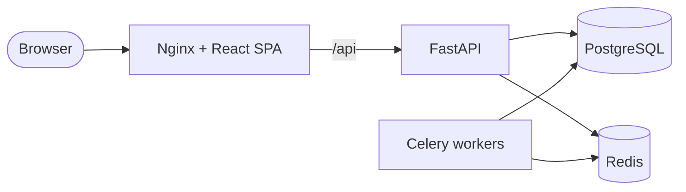

# SentinelX

**AI-assisted Attack Surface Management and vulnerability assessment platform —
built for authorized security testing and defensive monitoring.**

[](.github/workflows/ci.yml)


SentinelX centralizes the security lifecycle of the assets you are authorized to
assess: register and scope assets, discover exposed services, analyze TLS and web
configurations, detect known vulnerabilities, correlate them with NVD threat
intelligence, prioritize risk with a transparent model, monitor security events,
and generate evidence-based reports — with an optional AI analyst that explains
findings and drafts remediation, never inventing evidence.

> **Project status — Phase 10 (Reporting) complete.** The platform skeleton,
> infrastructure, quality gates and architecture are in place. Security features
> are delivered phase by phase; see the [roadmap](docs/ROADMAP.md).

> ⚠️ **Authorized use only.** SentinelX is designed to test assets you own or have
> written permission to assess. Scanning enforces a deny-by-default
> [scanning policy](docs/SCANNING_POLICY.md).

## Features

| Area | Capability | Status |
|------|------------|--------|
| Platform | Modular FastAPI API, Celery workers, React SPA, PostgreSQL, Redis, Docker Compose | ✅ Phase 1 |
| Observability | Structured JSON logs, correlation IDs, secret redaction, health/readiness probes | ✅ Phase 1 |
| DevSecOps | CI with lint, strict typing, tests, Gitleaks, Bandit, Semgrep, pip-audit, pnpm audit, Trivy, compose E2E | ✅ Phase 1 |
| Identity | Argon2id, rotating refresh tokens with reuse detection, CSRF, lockout, rate limiting, RBAC (Admin / Analyst / Viewer), project isolation, append-only audit log | ✅ Phase 2 |
| Assets & scope | Authorized asset inventory, immutable authorization records, deny-by-default scope engine (SSRF, DNS rebinding, IPv4-in-IPv6, redirects) with explained decisions | ✅ Phase 3 |
| Reconnaissance | Asynchronous scan jobs; DNS posture, passive CT subdomains, TLS analysis, HTTP fingerprinting, Nmap safe profiles in a credential-free sandbox; quotas and emergency stop | ✅ Phase 4 |
| Vulnerabilities | OWASP ZAP (isolated daemon) and pinned, curated Nuclei behind a scope-enforcing egress guard; deterministic findings with deduplication, regressions, triage and evidence | ✅ Phase 5 |
| Threat intel | Product-driven NVD CVE sync, CISA KEV, CPE version-range correlation into tentative CVE findings, software inventory | ✅ Phase 6 |
| Risk | Deterministic, versioned risk scores (CVSS, confidence, asset context, KEV, EPSS, age) with factor-level explanations, project posture and trend, audited admin weights | ✅ Phase 7 |
| Monitoring | Security event timeline, alert rules, signed webhooks and e-mail with retries, scheduled scans | ✅ Phase 8 |
| AI analyst | Optional Claude-backed explanations, scan summaries and comparisons, executive/technical summaries — evidence-labelled, pseudonymized, budgeted, with deterministic fallback and human review | ✅ Phase 9 |
| Reporting | PDF and JSON reports (project or scan): scope, authorizations, methodology, findings with evidence and risk, remediation plan, reviewed AI commentary labelled, SHA-256 integrity | ✅ Phase 10 |

## Architecture



A modular monolith with isolated asynchronous workers; data stores live on an
internal network with no internet egress. Details and decision records:
[docs/ARCHITECTURE.md](docs/ARCHITECTURE.md).

## Screenshots

_Phase 2 ships sign-in, users & roles, projects with membership, the audit log and
the system status page._ Screenshots of the full product will be added as
security feature pages land.

## Technology

**Backend:** Python 3.12, FastAPI, Pydantic 2, SQLAlchemy 2 (async) + asyncpg,
Alembic, Celery, Redis, structlog, uv · **Frontend:** React 19, TypeScript,
Vite, Tailwind CSS v4, shadcn/ui conventions on Radix, React Router, TanStack
Query, Zod · **Testing:** Pytest, Vitest, React Testing Library, Playwright ·
**Infra:** Docker, Docker Compose, Nginx, GitHub Actions.

## Quick start (Docker)

Prerequisites: Docker Engine 24+ with Compose v2, GNU Make, Python 3 (only to
generate secrets).

```bash
git clone <your-fork-url> sentinelx && cd sentinelx
make env      # writes .env with random secrets
make up       # builds, migrates and starts the stack (waits for health)
make admin    # creates the first administrator account
make smoke    # verifies readiness through Nginx and a worker task
```

Open **http://localhost:8080**. API docs: http://localhost:8000/api/docs.
Stop with `make down` (or `make clean` to also delete data volumes).

## Local development (without Docker)

Prerequisites: [uv](https://docs.astral.sh/uv/) ≥ 0.13, Node.js ≥ 22.12, pnpm 10.

```bash
make install            # uv sync + pnpm install
make check              # lint, types, tests, security audits
make dev-api            # API on :8000 (needs reachable PostgreSQL/Redis, see .env.example)
make dev-web            # Vite on :5173, proxies /api to :8000
```

Run `make help` for every target.

## Testing

```bash
make test               # backend (coverage gate 85%) + frontend unit tests
make test-integration   # against real PostgreSQL + Redis
make test-e2e           # Playwright against a running stack
```

See [docs/TESTING.md](docs/TESTING.md) for the strategy and latest results.

## Documentation

| Document | Contents |
|----------|----------|
| [ARCHITECTURE](docs/ARCHITECTURE.md) | Components, layering, ADRs |
| [ROADMAP](docs/ROADMAP.md) | Phases, acceptance criteria, success checklist |
| [DATABASE](docs/DATABASE.md) | Conventions, ER diagram, entity proposal, tenancy |
| [API](docs/API.md) | Conventions, error format, endpoints |
| [AUTHENTICATION](docs/AUTHENTICATION.md) | Credentials, tokens, sessions, CSRF, RBAC, audit |
| [SECURITY](docs/SECURITY.md) | Controls and CI quality gates |
| [THREAT_MODEL](docs/THREAT_MODEL.md) | STRIDE analysis and mitigations |
| [SCANNING_POLICY](docs/SCANNING_POLICY.md) | What may be scanned, how, and what is prohibited |
| [RISK_MODEL](docs/RISK_MODEL.md) | Risk formula, factors, weights, posture and governance |
| [TESTING](docs/TESTING.md) | Test pyramid and commands |
| [DEPLOYMENT](docs/DEPLOYMENT.md) | Docker strategy, configuration, CI/CD |

## Contributing & security

See [CONTRIBUTING.md](CONTRIBUTING.md). Report vulnerabilities privately as
described in [SECURITY.md](SECURITY.md).

## License

[MIT](LICENSE)
