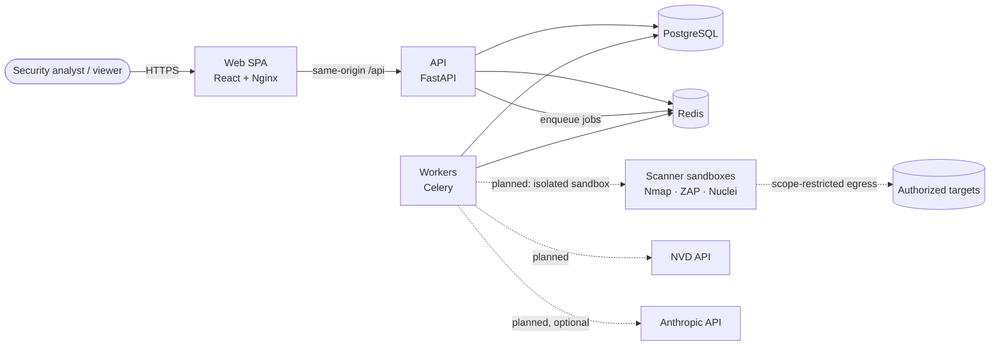

# SentinelX Architecture

> Status: **Phase 1 — Foundation** delivered. Sections marked _(planned)_ describe
> the target design that later phases implement; they are not yet built.

## 1. Goals and constraints

SentinelX is an authorized-use Attack Surface Management and vulnerability
assessment platform with AI-assisted analysis. The architecture optimizes for:

1. **Safety of scanning** — the platform must never become an open scanning proxy.
   Every active network operation is scope-checked, policy-checked and isolated.
2. **Evidence integrity** — findings, CVEs and risk scores are traceable to their
   source; AI output is always labeled and never treated as evidence.
3. **Maintainability** — a modular monolith with explicit module boundaries that
   can be extracted later without rewriting business logic.
4. **Reproducibility** — one command brings up the full stack; pinned
   dependencies and lockfiles everywhere.

## 2. System context



## 3. Runtime components

| Component | Technology | Responsibility | Network |
|-----------|------------|----------------|---------|
| `web` | React 19, Vite, Nginx (unprivileged) | SPA delivery, `/api` reverse proxy, security headers | `frontend` |
| `api` | FastAPI, SQLAlchemy 2 (async), Pydantic 2 | REST API, authn/z, validation, job submission | `frontend`, `backend` |
| `worker` | Celery 5 | Asynchronous jobs (scans, enrichment, reports) | `backend` (internal, no egress) |
| `migrate` | Alembic | One-shot schema migration before API/worker start | `backend` |
| `postgres` | PostgreSQL 17 | System of record | `backend` |
| `redis` | Redis 7.4 | Celery broker/result backend, cache, rate-limit counters | `backend` |
| scanner sandboxes _(planned)_ | Nmap, OWASP ZAP, Nuclei containers | Execute a single, pre-validated scan profile | dedicated egress network |

The `backend` network is `internal: true`: PostgreSQL, Redis and workers have no
route to the internet. Outbound access is granted later only to the components
that need it (NVD sync, scanner sandboxes), through a dedicated, policy-controlled
egress network (see [SCANNING_POLICY.md](SCANNING_POLICY.md)).

## 4. Repository layout

```
apps/
  api/                 FastAPI application (Python package `app`)
    app/
      api/v1/          HTTP layer: routers & endpoints only
      core/            config, logging, error handling
      db/              engine/session factory, declarative base
      dependencies/    FastAPI dependency providers (DI seams)
      middleware/      pure-ASGI middleware (correlation, security headers)
      schemas/         Pydantic request/response models
      services/        application/business logic
    migrations/        Alembic revisions
    tests/             unit, api, integration
  web/                 React + TypeScript SPA
    src/app/           providers, router, app-level pages
    src/components/    ui/ (design-system primitives), shared/
    src/features/      feature modules (one folder per domain)
    src/layouts/  src/lib/
    tests/             test setup + Playwright E2E
workers/               Celery app + tasks (Python package `sentinelx_workers`)
infrastructure/docker/ Dockerfiles and Nginx config
scripts/               developer tooling
docs/                  documentation
.github/workflows/     CI/CD
```

Modules introduced by later phases follow the layout in the master plan:
`security-engine/`, `threat-intelligence/` and `ai-engine/` become uv workspace
members when their phase starts (see ADR-002). Directories are not created empty
ahead of time.

## 5. Backend layering

```
HTTP (api/v1)  →  services  →  repositories (Phase 2+)  →  SQLAlchemy models
       ↑               ↑
  dependencies    schemas (Pydantic)
```

* Endpoints are thin: parse/validate input, call a service, map the result.
* Services hold business rules and are framework-agnostic (testable without HTTP).
* Repositories (from Phase 2) encapsulate queries and **always** take a
  `project_id` scope so cross-tenant reads are structurally impossible.
* Dependencies are injected through FastAPI `Depends` providers in
  `app/dependencies/`; tests replace them with `app.dependency_overrides`.
* Infrastructure clients (engine, Redis) are created in the application
  lifespan and attached to `app.state`; nothing connects at import time.

### Cross-cutting concerns (implemented)

| Concern | Implementation |
|---------|----------------|
| Configuration | `pydantic-settings`, `SENTINELX_*` env vars, secrets as `SecretStr`, production guards |
| Logging | `structlog` JSON, request-ID binding, key-based + URL-credential redaction |
| Correlation | `X-Request-ID` validated/generated per request, echoed in responses and error bodies |
| Errors | One error envelope `{error:{code,message,request_id,details}}`; no internals leaked |
| Security headers | Strict API CSP, `nosniff`, `DENY` framing, `no-store`, HSTS in production |
| Host validation | `TrustedHostMiddleware` allowlist (no wildcard permitted) |
| CORS | Disabled unless an explicit origin allowlist is configured |
| Health | `/health/live` (process) and `/health/ready` (DB + Redis, concurrent, time-bounded) |

## 6. Frontend architecture

* **Feature folders** (`src/features/<domain>`) own their API hooks, Zod schemas
  and components. Shared primitives live in `src/components/ui` (shadcn/ui
  conventions on Radix primitives) and `src/components/shared`.
* **Data fetching**: TanStack Query. All responses pass through a typed client
  (`src/lib/api-client.ts`) that validates payloads with Zod and normalizes errors
  into `ApiError` (status, code, request ID).
* **Routing**: React Router data router; route-level code splitting will be
  introduced as pages are added.
* **Design system**: dark-first tokens (navy/charcoal surfaces, cyan accent,
  dedicated severity and status scales) defined once in `src/styles/globals.css`
  and exposed as Tailwind v4 theme variables.
* **Authorization in the UI is cosmetic only**; the API enforces every permission.

## 7. Asynchronous execution

Long-running work (scans, enrichment, report generation, AI analysis) is
submitted as a job and executed by Celery workers. The API immediately returns a
job identifier; clients poll job state (`pending → queued → running →
completed | failed | cancelled`) _(job model planned for Phase 4)_.

Worker defaults (implemented): JSON-only serialization (no pickle), soft/hard time
limits, late acknowledgement with reject-on-worker-lost, prefetch multiplier of 1.

## 8. Architecture Decision Records

### ADR-001 — Modular monolith with isolated workers
**Decision:** a single FastAPI deployable plus Celery workers, with module
boundaries enforced by package structure and layering.
**Rationale:** the domain is still evolving; microservices would add network
failure modes, distributed transactions and operational cost without a scaling
need. Workers are already a separate process, so heavy/unsafe work is isolated.
**Consequences:** modules must not import each other's internals; communication
goes through services. Extraction later is a packaging change, not a rewrite.

### ADR-002 — uv workspace for Python packages
**Decision:** Python code is organized as a [uv workspace](https://docs.astral.sh/uv/concepts/projects/workspaces/)
with one lockfile (`uv.lock`). Members: `apps/api` (`sentinelx-api`),
`workers` (`sentinelx-workers`) and, since Phase 3, `security-engine`
(`sentinelx-security`: the framework-independent scope engine). Future engines (`security-engine`,
`threat-intelligence`, `ai-engine`) join as members with importable package names
(hyphenated directory names are not valid Python modules).
**Rationale:** a single resolved dependency set across API and workers, fast and
reproducible installs, and explicit inter-package dependencies.

### ADR-003 — Async SQLAlchemy 2 with asyncpg
**Decision:** async engine and sessions for the API; Alembic runs migrations
through the same async driver.
**Rationale:** the API is I/O bound (DB, Redis, external APIs); async avoids
thread-pool exhaustion. SQLAlchemy 2 typing integrates with mypy strict.

### ADR-004 — Celery + Redis for background jobs
**Decision:** Celery with Redis as broker and result backend (separate logical DBs).
**Rationale:** mature retry/time-limit/acknowledgement semantics, well-understood
operations. Redis is already required for caching and rate limiting.
**Trade-off:** Redis is not a durable queue; job state is persisted in PostgreSQL
(Phase 4) so a Redis loss never loses the record of a scan.

### ADR-005 — Same-origin frontend, CORS off by default
**Decision:** the SPA reaches the API through `/api` on its own origin (Vite proxy
in development, Nginx in containers).
**Rationale:** allows `SameSite=strict` HttpOnly cookies for the refresh token in
Phase 2, removes a whole class of CORS misconfiguration risk.

### ADR-006 — Scanner execution in dedicated sandboxes _(planned, Phase 4)_
**Decision:** workers never run Nmap/ZAP/Nuclei in-process. Each scan runs in a
short-lived, non-root container with a read-only filesystem, dropped
capabilities (only what the scan profile needs, e.g. `NET_RAW` for SYN scans if
ever enabled), CPU/memory/time limits, no access to application secrets or the
`backend` network, and egress limited to the resolved, authorized target IPs.
**Rationale:** scanner binaries parse hostile input; compromise of a scanner must
not reach the database, Redis or credentials.

### ADR-007 — AI is optional, advisory and isolated _(planned, Phase 9)_
**Decision:** AI features sit behind a provider interface; the platform is fully
functional without an API key. AI receives minimized, delimited, untrusted-labeled
inputs, has no tool execution, and every response is schema-validated and stored
with prompt version, model and token usage.

## 9. Deviations from the master plan

| Plan | Implementation | Reason |
|------|----------------|--------|
| `apps/api/app/models/` holds the base | Declarative base in `app/db/base.py`; domain models will live in `app/models/` | Separates persistence plumbing from domain models |
| Root `tests/e2e/` | Playwright suite in `apps/web/tests/e2e/` | Shares the web toolchain, lockfile and TS config |
| Top-level engine folders created up front | Created when their phase starts | Avoid empty placeholder packages |
