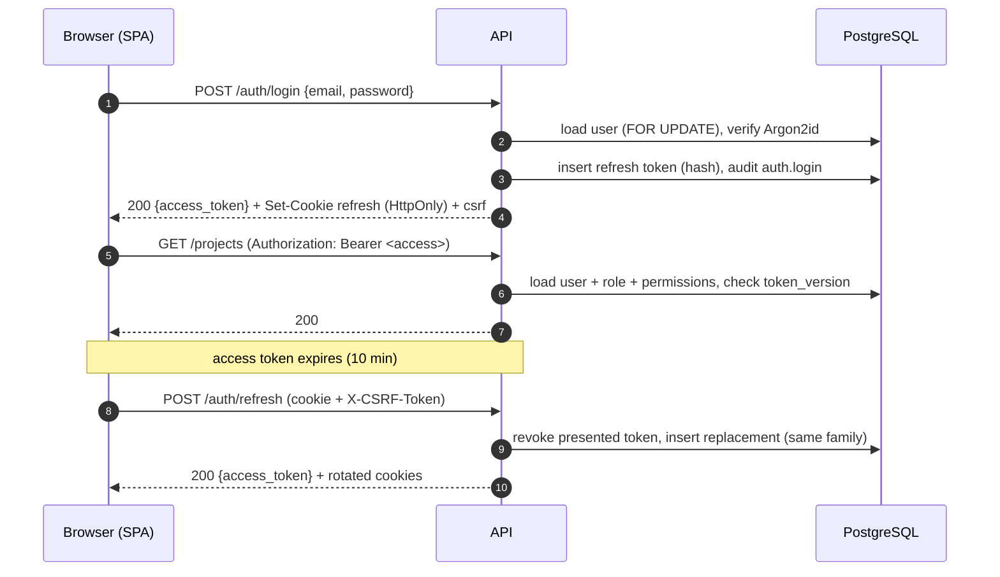

# Authentication, Sessions & Authorization

> Implemented in Phase 2. Threats addressed: T8–T11 and T20 in
> [THREAT_MODEL.md](THREAT_MODEL.md).

## Overview

## Credentials

| Aspect | Implementation |
|--------|----------------|
| Password hashing | Argon2id (`argon2-cffi`), m=19 MiB, t=2, p=1 (OWASP minimum; enforced in production). Hashes are upgraded transparently on login when parameters change. |
| Password policy | 12–128 characters, not blank, not equal to the email or its local part. No composition rules (NIST SP 800-63B). |
| Unknown accounts | Verified against a dummy hash so response time does not reveal whether an email exists. |
| Lockout | After `SENTINELX_LOGIN_MAX_FAILURES` (5) failures the account is locked for `SENTINELX_LOGIN_LOCKOUT_SECONDS` (15 min). Locked accounts receive the same generic error. |
| Rate limiting | Redis fixed windows: login per IP and per email (10/min), refresh per IP (60/min), password reset per IP and per email (5/h), registration per IP (5/h). Responses: `429` + `Retry-After`. Fails open if Redis is down (lockout still applies). |
| Bootstrap | `sentinelx-admin create-admin --email …` (password via prompt or `SENTINELX_BOOTSTRAP_ADMIN_PASSWORD`, never argv). Self-registration is off by default and only creates Viewers. |

## Tokens

| Token | Format | Lifetime | Storage (client) | Storage (server) |
|-------|--------|----------|------------------|------------------|
| Access | JWT HS256: `sub`, `ver`, `typ=access`, `iss`, `aud`, `iat`, `nbf`, `exp`, `jti` | 10 min | JavaScript memory only | — |
| Refresh | 256-bit random, URL-safe | 7 days | `sentinelx_refresh` cookie: HttpOnly, Secure, SameSite=Strict, Path=`/api/v1/auth` | SHA-256 digest |
| CSRF | `nonce.HMAC(secret, family_id.nonce)` | session | `sentinelx_csrf` cookie (readable) + `X-CSRF-Token` header | — (stateless, verified by HMAC) |
| Password reset | 256-bit random, single use | 30 min | URL fragment (`#token=`), removed from history after reading | SHA-256 digest |

* Access tokens never carry authorization data. Role and permissions are loaded
  from the database on every request, so role changes apply immediately.
* `users.token_version` is incremented on password change/reset, deactivation and
  forced sign-out; access tokens with an older version are rejected at once.
* Only `HS256` is accepted (no `none`, no algorithm confusion); issuer, audience,
  type and all required claims are validated.

## Sessions and refresh-token rotation

A login creates a **session family**. Each refresh revokes the presented token and
links it to its replacement. If a token that was already rotated is presented
again, it can only be a copy (theft or replay): the whole family is revoked and
`auth.refresh_token_reuse` is audited. The SPA serializes refreshes (single-flight)
so legitimate parallel requests never trigger this.

Users can list and revoke their sessions (`/auth/sessions`); administrators can sign
a user out everywhere (`/users/{id}/revoke-sessions`).

## CSRF

Only cookie-authenticated endpoints (`/auth/refresh`, `/auth/logout`) need CSRF
protection; everything else requires the `Authorization` header, which browsers
never attach automatically. Defenses: `SameSite=Strict` cookies, a narrow refresh
cookie path, and a signed double-submit token bound to the session family (a token
planted by a sibling subdomain does not verify).

## Authorization (RBAC)

| Role | Permissions |
|------|-------------|
| Admin | All permissions |
| Security Analyst | `projects:read`, `assets:read/write`, `scans:read/execute`, `findings:read/write`, `intelligence:read`, `events:read`, `reports:read/generate`, `ai:use` |
| Viewer | `projects:read`, `assets:read`, `scans:read`, `findings:read`, `intelligence:read`, `events:read`, `reports:read` |

* Source of truth: `app/core/permissions.py`; seeded by migration `0002`; an
  integration test asserts database and code agree.
* Every endpoint declares `require_permission(...)`; the frontend only hides controls.
* **Tenancy:** non-admins see only projects they are members of. Repositories add
  the membership condition to every query and return `404` (not `403`) for other
  projects, so identifiers of other tenants cannot be probed.
* Guards: administrators cannot demote or deactivate themselves, and the last
  active administrator cannot be removed.

## Audit trail

`audit_logs` is append-only: a PostgreSQL trigger rejects `UPDATE` and `DELETE`.
Entries snapshot the actor's email (no foreign keys, so history survives user and
project deletion) and record IP, user agent, request ID, outcome and minimal
details. Recorded actions: `auth.login` (success/failure with internal reason),
`auth.account_locked`, `auth.logout`, `auth.refresh_token_reuse`,
`auth.password_changed`, `auth.password_reset_requested`,
`auth.password_reset_completed`, `auth.session_revoked`, `auth.registered`,
`user.created`, `user.updated`, `user.sessions_revoked`, `project.created`,
`project.updated`, `project.deleted`, `project.member_added`,
`project.member_removed`.

## Known limitations

* Email delivery: only `console` (development) and `disabled` backends exist; a
  production SMTP/provider backend is required before enabling password reset in
  production.
* No multi-factor authentication yet (planned for the hardening phase).
* The reset-request endpoint does slightly more work for existing accounts
  (token creation, email); timing differences are bounded by rate limiting.
