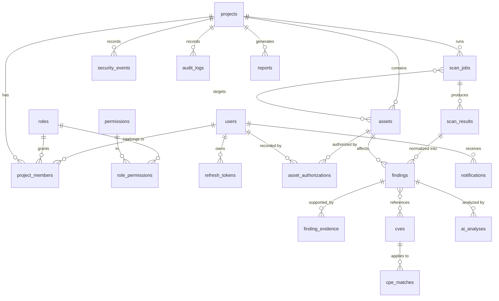

# SentinelX Database Design

> Phase 1 ships the database foundation (engine, session factory, declarative
> base, naming conventions, Alembic baseline). The entities below are the
> **proposal** that later phases implement, each with its own migration.

## Conventions

| Topic | Rule |
|-------|------|
| Primary keys | `UUID` (generated by the application, `uuid4`; may move to UUIDv7 for index locality) |
| Timestamps | `timestamptz`, always UTC, `created_at` / `updated_at` on every mutable table |
| Constraint names | Deterministic naming convention (`pk_`, `fk_`, `uq_`, `ix_`, `ck_`) in `app/db/base.py` |
| Tenancy | Every tenant-owned row carries `project_id`; repositories require it on every query |
| Deletion | Soft-delete (`deleted_at`) for assets and findings to preserve audit history |
| Enumerations | PostgreSQL `CHECK` constraints or native enums, mirrored by Python `StrEnum` |
| JSON | `jsonb` only for genuinely schemaless data (raw scanner output, risk factors), never for relational data |
| Secrets | Never stored in plaintext; tokens stored as SHA-256 hashes; passwords as Argon2id |
| Migrations | Alembic, one revision per change, reviewed; `alembic check` in CI keeps models and migrations in sync |

## Entity-relationship overview

## Entity proposal

| Table | Key columns | Notes |
|-------|-------------|-------|
| `users` | email (unique, citext), password_hash, is_active, last_login_at, failed_login_count, locked_until | Global identity |
| `roles` | name (`admin`, `security_analyst`, `viewer`), description | Seeded by migration |
| `permissions` | code (e.g. `assets:write`, `scans:execute`) | Seeded; least-privilege mapping |
| `role_permissions` | role_id, permission_id | Composite PK |
| `projects` | name, slug (unique), description, owner_id | Tenant boundary |
| `project_members` | project_id, user_id, role_id | Unique (project_id, user_id); role is per project |
| `refresh_tokens` | user_id, token_hash (unique), family_id, expires_at, revoked_at, replaced_by_id, user_agent, ip | Rotation + reuse detection |
| `assets` | project_id, type, value (normalized), criticality, exposure, status, tags (array), scan_eligible | Unique (project_id, type, value) |
| `asset_authorizations` | asset_id, authorized_by (name/organization), reference (contract/ticket), scope_definition (jsonb), valid_from, valid_until, active_scanning_allowed, recorded_by | Required before any active scan |
| `scan_jobs` | project_id, type, profile, status (pending/queued/running/completed/failed/cancelled), requested_by, started_at, finished_at, correlation_id, tool_versions (jsonb), error_code | Persistent job record |
| `scan_job_assets` | scan_job_id, asset_id, resolved_targets (jsonb) | Exact IPs validated at execution time |
| `scan_results` | scan_job_id, scanner, raw_output_ref, normalized (jsonb), checksum | Raw output stored as untrusted data |
| `findings` | project_id, asset_id, fingerprint (unique per project), title, description, source, severity, confidence, status, cvss_vector, cvss_score, first_seen_at, last_seen_at, remediation | Deduplicated by fingerprint |
| `finding_evidence` | finding_id, scan_result_id, kind, content, collected_at | Immutable |
| `finding_status_history` | finding_id, from_status, to_status, changed_by, reason | Lifecycle audit |
| `cves` | cve_id (unique), description, cvss_v3/v4 vectors & scores, cwe_ids, published_at, modified_at, references (jsonb), source, fetched_at | Provenance + timestamps |
| `cpe_matches` | cve_id, cpe23, version_start/end (incl/excl), vulnerable | Version-range matching |
| `finding_cves` | finding_id, cve_id, match_confidence, match_method | No CVE asserted from product name alone |
| `risk_assessments` | finding_id, model_version, original_cvss, score, category, factors (jsonb), explanation, calculated_at | Deterministic & versioned |
| `security_events` | project_id, type, severity, asset_id, finding_id, payload (jsonb), occurred_at | Timeline; indexed by (project_id, occurred_at) |
| `audit_logs` | project_id (nullable), actor_id, action, target_type, target_id, ip, user_agent, correlation_id, metadata (jsonb), created_at | Append-only |
| `ai_analyses` | project_id, subject_type, subject_id, provider, model, prompt_version, input_hash, output (jsonb), tokens_in/out, cost_estimate, status | AI output stored separately from evidence |
| `reports` | project_id, format (pdf/json), status, generated_by, file_ref, checksum, parameters (jsonb) | Generated asynchronously |
| `notifications` | user_id, channel, type, payload, read_at, delivered_at | Channel abstraction |

## Key indexes (planned)

* `findings (project_id, status, severity)` — vulnerability management filters.
* `findings (project_id, fingerprint)` unique — deduplication across scans.
* `security_events (project_id, occurred_at DESC)` — timeline queries.
* `audit_logs (project_id, created_at DESC)` and `(actor_id, created_at DESC)`.
* `scan_jobs (project_id, status, created_at DESC)` — active scans widget.
* `refresh_tokens (token_hash)` unique, `(family_id)`.

## Tenant isolation

1. Repositories accept a `ProjectScope` value (project ID + caller permissions)
   and add `WHERE project_id = :project_id` to every query.
2. API dependencies resolve the scope from the authenticated user's membership;
   endpoints never accept a raw `project_id` without that check.
3. Integration tests assert that every list/detail endpoint returns 404 (not 403)
   for resources in other projects, to avoid existence disclosure.
4. PostgreSQL Row-Level Security is evaluated as defense in depth in Phase 12.
