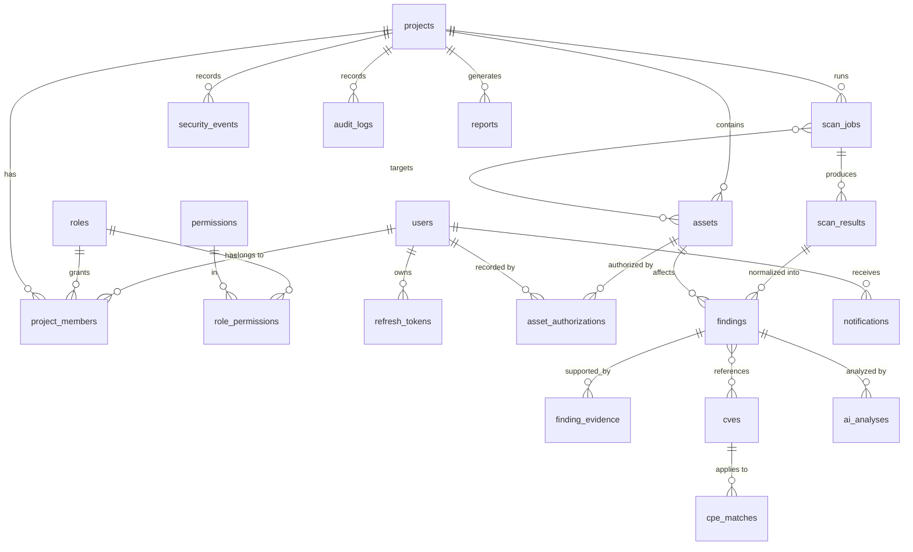

# SentinelX Database Design

> **Implemented:** foundation (Phase 1) and identity, access & tenancy (Phase 2,
> migration `0002`): `users`, `roles`, `permissions`, `role_permissions`,
> `refresh_tokens`, `password_reset_tokens`, `projects`, `project_members`,
> `audit_logs`; assets & scope (Phase 3, migration `0003`): `assets`,
> `asset_authorizations`. Remaining entities below are the proposal for later phases.
>
> **Design change in Phase 2:** roles are assigned per user (platform-wide) and
> project membership grants access. A per-project role override can be added to
> `project_members` later without changing the authorization API.
> `audit_logs` has no foreign keys (actor email is snapshotted) and is protected
> by an append-only trigger.

## Conventions

| Topic | Rule |
|-------|------|
| Primary keys | `UUID` (generated by the application, `uuid4`; may move to UUIDv7 for index locality) |
| Timestamps | `timestamptz`, always UTC, `created_at` / `updated_at` on every mutable table |
| Constraint names | Deterministic naming convention (`pk_`, `fk_`, `uq_`, `ix_`, `ck_`) in `app/db/base.py` |
| Tenancy | Every tenant-owned row carries `project_id`; repositories require it on every query |
| Deletion | Soft-delete (`deleted_at`) for assets and findings to preserve audit history |
| Enumerations | PostgreSQL `CHECK` constraints or native enums, mirrored by Python `StrEnum` |
| JSON | `jsonb` only for genuinely schemaless data (raw scanner output, risk factors), never for relational data |
| Secrets | Never stored in plaintext; tokens stored as SHA-256 hashes; passwords as Argon2id |
| Migrations | Alembic, one revision per change, reviewed; `alembic check` in CI keeps models and migrations in sync |

## Entity-relationship overview

## Entity proposal

| Table | Key columns | Notes |
|-------|-------------|-------|
| `users` | email (unique, citext), password_hash, is_active, last_login_at, failed_login_count, locked_until | Global identity |
| `roles` | name (`admin`, `security_analyst`, `viewer`), description | Seeded by migration |
| `permissions` | code (e.g. `assets:write`, `scans:execute`) | Seeded; least-privilege mapping |
| `role_permissions` | role_id, permission_id | Composite PK |
| `projects` | name, slug (unique), description, owner_id | Tenant boundary |
| `project_members` | project_id, user_id, role_id | Unique (project_id, user_id); role is per project |
| `user_mfa` ✅ | user_id (PK, FK), secret_encrypted (Fernet), confirmed_at, last_used_step, recovery_code_hashes (jsonb, SHA-256), created_at | TOTP second factor (Phase 12, migration `0011`); one row per user, unconfirmed until the first valid code |
| `refresh_tokens` | user_id, token_hash (unique), family_id, expires_at, revoked_at, replaced_by_id, user_agent, ip | Rotation + reuse detection |
| `assets` | project_id, type, value (normalized), criticality, exposure, status, tags (array), scan_eligible | Unique (project_id, type, value) |
| `asset_authorizations` | asset_id, authorized_by (name/organization), reference (contract/ticket), scope_definition (jsonb), valid_from, valid_until, active_scanning_allowed, recorded_by | Required before any active scan |
| `scan_jobs` ✅ | project_id, asset_id, scanner, profile, technique, target, status (check constraint: pending/queued/running/completed/failed/cancelled), requested_by_id, correlation_id, executor_task_id, created/queued/started/finished/cancel_requested_at, error_code, error_message, scope_decision (jsonb), pinned_addresses (array), tool_versions (jsonb), summary (jsonb) | Persistent job record (Phase 4). Pinned addresses are the exact IPs validated at execution time |
| `scan_results` ✅ | scan_job_id, project_id, kind, key, data (jsonb), attention (array) | Normalized observations (open port, TLS endpoint, DNS record, technology…); untrusted data |
| `scan_evidence` ✅ | scan_job_id, label, media_type, content (text, ≤ 64 KiB) | Bounded raw tool output (Nmap XML summary, certificates, response headers) |
| `platform_settings` ✅ | key (PK), value (jsonb), updated_at, updated_by_id | Operational switches, e.g. `scans.halted` (emergency stop) |
| `findings` ✅ | project_id, asset_id, fingerprint (sha256 of asset + rule + location; unique per project), rule_id, ruleset_version, source, category, title, description, remediation, location, severity, confidence, cwe, references, status (open/acknowledged/false_positive/accepted_risk/resolved), status_reason, first/last_seen_at, resolved_at, last_scan_job_id, last_profile, occurrence_count | Deduplicated; check constraints on severity/confidence/status (Phase 5). CVSS arrives with threat intelligence (Phase 6) |
| `finding_occurrences` ✅ | finding_id, scan_job_id, observed_at, observation (jsonb snapshot) | Evidence trail per sighting |
| `finding_status_changes` ✅ | finding_id, from_status, to_status, reason, changed_by_id, changed_by_email, created_at | Lifecycle history (automatic changes have no user) |
| `cves` ✅ | id (CVE ID, PK), source, description, status, published/last_modified_at, preferred cvss (version, vector, score, severity), cvss31_*, cvss40_*, cwes, references, kev_added_on, kev_due_on, kev_ransomware, fetched_at | Provenance + timestamps (Phase 6) |
| `cve_matches` ✅ | cve_id, criteria (CPE 2.3), vendor, product, version, update, start/end including/excluding | Only *vulnerable* criteria; indexed by (vendor, product) |
| `intel_product_syncs` ✅ | (vendor, product) PK, requested_at, synced_at, status, cve_count, error | Product-driven NVD sync state |
| `intel_sources` ✅ | name PK (e.g. `kev`), synced_at, status, version, records, error | Feed sync state |
| `software_components` ✅ | project_id, asset_id, source (scanner), name, version, update, raw_version, cpes, location, correlatable, first/last_seen_at, last_scan_job_id | Inventory replaced per asset + scanner on every completed scan |

CVE findings are regular `findings` rows (`rule_id = cve.<CVE-ID>`, `source = intel`,
`confidence = tentative`); the CVE, CPE criterion and matched range are kept in
the occurrence snapshot, so no separate `finding_cves` table is needed.
| `findings` risk columns ✅ | cve_id, risk_score, risk_band, risk_model_version, risk_factors (jsonb), risk_explanation, risk_calculated_at | Current score stored on the finding (Phase 7); index (project_id, risk_score) |
| `finding_risk_changes` ✅ | finding_id, score, band, model_version, trigger, factors (jsonb), calculated_at | Written only when score/band/model changes |
| `project_risk_snapshots` ✅ | project_id, day (unique together), score, band, active, counts (jsonb), model_version | Daily posture for trends |
| `cves` EPSS columns ✅ | epss_score, epss_percentile, epss_scored_on | FIRST EPSS, refreshed daily for CVEs in active findings |
| `security_events` ✅ | project_id, event_type, severity, title, asset_id, finding_id, scan_job_id (all `SET NULL`), dedup_key, details (jsonb), actor_email, occurred_at | Timeline written in the same transaction as the change (Phase 8); indexes (project_id, occurred_at), (project_id, event_type), (asset_id) |
| `notification_channels` ✅ | project_id, name (unique per project), kind (email/webhook), enabled, config (jsonb: recipients or url), secret_encrypted (Fernet), created_by_id | Webhook signing secret never stored in clear |
| `alert_rules` ✅ | project_id, name (unique per project), enabled, event_types (array; empty = all), min_severity, asset_id (optional), quiet_period_minutes (0–10080), created_by_id | Matched when an event is emitted |
| `alert_rule_channels` ✅ | rule_id, channel_id | Composite PK; cascades |
| `scan_schedules` ✅ | project_id, asset_id, scanner, profile, interval_hours (1–2160), enabled, next_run_at, last_run_at, last_status, last_message, last_scan_job_id, owner_id | Runs as its owner through the interactive request path; index (enabled, next_run_at) |
| `audit_logs` | project_id (nullable), actor_id, action, target_type, target_id, ip, user_agent, correlation_id, metadata (jsonb), created_at | Append-only |
| `ai_analyses` ✅ | project_id, kind, subject_type, subject_id, parameters (jsonb), status (pending/running/completed/failed), provider (anthropic/deterministic), model, prompt_version, input_hash, context_summary (jsonb: item counts and refs, never content), output (jsonb), warnings (jsonb), fallback_reason, error, input/output_tokens, cost_usd, duration_ms, requested_by_id, reviewed_by_id/email, reviewed_at, correlation_id, created/completed_at | AI output stored separately from evidence (Phase 9); indexes (project_id, created_at), (project_id, subject_id, kind), (input_hash) |
| `reports` ✅ | project_id, scope (project/scan), scan_job_id, format (pdf/json), title, parameters (jsonb), status, schema_version, content (bytea, deferred, ≤ 25 MB), size_bytes, sha256, summary (jsonb), error, generated_by_id/email, correlation_id, created/completed_at | Generated asynchronously (Phase 10); index (project_id, created_at); check: scan scope requires a scan |
| `notifications` ✅ | project_id, event_id, rule_id (nullable for tests), channel_id, status (pending/sent/failed/suppressed), attempts, next_attempt_at, last_error, response_status, sent_at, created_at | Outbox and delivery log (Phase 8); index (status, next_attempt_at) |

## Key indexes (planned)

* `findings (project_id, status, severity)` ✅ — vulnerability management filters.
* `findings (project_id, fingerprint)` unique ✅ — deduplication across scans.
* `security_events (project_id, occurred_at)` ✅ — timeline queries.
* `notifications (status, next_attempt_at)` ✅ — outbox polling.
* `audit_logs (project_id, created_at DESC)` and `(actor_id, created_at DESC)`.
* `scan_jobs (project_id, status)` and `(project_id, created_at)` ✅ — quotas and listings.
* `scan_results (project_id, kind)` and `(scan_job_id)` ✅.
* `refresh_tokens (token_hash)` unique, `(family_id)`.

## Tenant isolation

1. Repositories accept a `ProjectScope` value (project ID + caller permissions)
   and add `WHERE project_id = :project_id` to every query.
2. API dependencies resolve the scope from the authenticated user's membership;
   endpoints never accept a raw `project_id` without that check.
3. Integration tests assert that every list/detail endpoint returns 404 (not 403)
   for resources in other projects, to avoid existence disclosure.
4. PostgreSQL Row-Level Security is evaluated as defense in depth in Phase 12.
