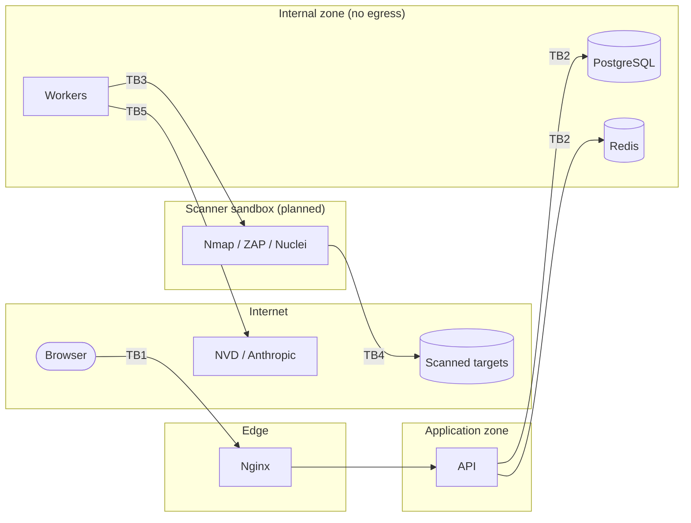

# SentinelX Threat Model

Method: STRIDE per trust boundary, revisited at the end of every phase.
Status column: **Implemented** (Phase 1), or the phase that implements it.

## 1. What we protect

| Asset | Why it matters |
|-------|----------------|
| Scan capability | Misuse turns SentinelX into an attack tool against third parties |
| Findings & evidence | Sensitive: a roadmap of how to compromise a customer |
| Asset inventory & authorizations | Reveals infrastructure; authorization records are legal evidence |
| Credentials & tokens | Account takeover, privilege escalation |
| Application secrets (DB, Redis, signing key, AI key) | Full platform compromise |
| AI analyses & reports | Must not contain fabricated or injected content |
| Audit logs | Accountability and incident response |

## 2. Actors

* **Viewer / Security Analyst / Admin** — authenticated, varying privileges.
* **Malicious insider** — legitimate account attempting to exceed its role or project.
* **External attacker** — unauthenticated access to the web/API surface.
* **Hostile target** — a scanned system returning crafted banners, HTML, TLS
  certificates or DNS records (parser exploits, prompt injection, XSS payloads).
* **Compromised dependency** — malicious package, image or scanner template.

## 3. Trust boundaries

TB1 user→platform · TB2 app→data stores · TB3 worker→sandbox · TB4 sandbox→targets · TB5 platform→third-party APIs.

## 4. Threats and mitigations

| ID | STRIDE | Threat | Mitigation | Status |
|----|--------|--------|------------|--------|
| T1 | E/T | Platform used as an open scanning proxy against unauthorized hosts | Deny-by-default scan policy; scans only on assets with an active authorization record; scope re-validated at execution; RBAC on scan execution; per-project quotas; audit trail | **Implemented** |
| T2 | S/E | SSRF / internal network access via asset targets (e.g. `169.254.169.254`, `localhost`, RFC1918, IPv6 ULA/link-local, IPv4-mapped IPv6) | Resolve-then-validate against blocklists and the authorized scope; IPv4-in-IPv6 unwrapping; numeric-host rejection; connect to the validated IP (no re-resolution); scanners in a sandbox without access to internal networks | **Implemented** (validation, scanner sandbox without DB/secrets); network egress firewall recommended for production |
| T3 | S | DNS rebinding between validation and scan time | Pin resolved IPs per decision; validate every resolution; scanners receive IPs, not names, where feasible | **Implemented** (pinning re-done at execution; all scanners connect to pinned IPs, sending the name only as SNI/Host) |
| T4 | E | Redirects leading out of scope (HTTP 30x to third-party or internal hosts) | Redirects followed manually with per-hop scope validation (`evaluate_redirect`); ZAP/Nuclei scope restricted to the authorized host set | **Implemented** — HTTP scanner never follows redirects; ZAP and Nuclei go through the egress guard, which refuses every hop outside the authorized host:port and connects only to pinned IPs (ZAP has no other network route) |
| T5 | E | Command injection into scanner invocations | No shell; argument vectors built from enumerated, server-side profiles; targets validated as IP/hostname literals; no user-provided flags | **Implemented** (profile allowlist, forbidden-option test, `create_subprocess_exec`) |
| T6 | T/E | Malicious scanner output exploiting parsers or the UI (stored XSS) | Output treated as untrusted data, size-limited, parsed with safe parsers (`defusedxml`), stored as text; React escaping; strict CSP (`script-src 'self'`, no inline) | **Implemented** |
| T7 | T | Prompt injection via banners/HTML/descriptions reaching the LLM | Delimited, labeled untrusted input; minimal context; no tools; schema-validated outputs; outputs never auto-applied; human review required | Phase 9 |
| T8 | I | Cross-project data exposure (IDOR) | Project-scoped repositories; membership-derived scope; 404 for foreign resources; tests per endpoint | **Implemented** (projects); extended per module |
| T9 | S | Credential stuffing / brute force | Argon2id; rate limiting; lockout; generic error messages; uniform timing; audit events | **Implemented** |
| T10 | S/E | Token theft or replay | Short-lived access tokens; rotating, hashed refresh tokens with reuse detection; HttpOnly/Secure/SameSite cookies; signed CSRF tokens; token_version revocation | **Implemented** |
| T11 | E | Privilege escalation through role manipulation | Server-side permission checks only; role changes restricted to Admin and audited; `extra=forbid` input schemas; last-admin protection | **Implemented** |
| T12 | I | Secrets in logs or error responses | `SecretStr`; key-based and URL-credential log redaction; generic 500s; no query strings in access logs; validation errors do not echo input | **Implemented** |
| T13 | I | Secrets committed to the repository | `.gitignore`, `.dockerignore`, generated `.env` (0600), Gitleaks in CI | **Implemented** |
| T14 | T | Host-header / cache poisoning | `TrustedHostMiddleware` allowlist; no wildcard allowed | **Implemented** |
| T15 | I | Clickjacking, MIME sniffing, referrer leakage | `X-Frame-Options: DENY`, `frame-ancestors 'none'`, `nosniff`, `Referrer-Policy: no-referrer` | **Implemented** |
| T16 | T/E | Deserialization attacks via the job broker | Celery JSON-only (`accept_content=["json"]`); Redis password-protected on an internal network | **Implemented** |
| T17 | D | Resource exhaustion (long scans, large outputs, many jobs) | Celery time limits (**Implemented**); container CPU/memory limits (**Implemented**); per-project concurrency/daily quotas, output size caps, stale-job expiry, emergency stop (**Implemented**) | **Implemented** |
| T18 | T | Supply-chain compromise (packages, images, actions, Nuclei templates) | Lockfiles; pinned image tags; GitHub Actions pinned by commit SHA; pip-audit, pnpm audit, Trivy; Dependabot; Nuclei binary and templates pinned by version **and SHA-256**, curated directories and excluded tags (**Implemented**); ZAP image pinned by tag; image digest pinning (Phase 12) | Partial |
| T19 | E | Container escape / lateral movement | Non-root users, `cap_drop: ALL`, `no-new-privileges`, read-only root FS for app containers, internal network for data stores | **Implemented** (app and scanner sandbox) |
| T20 | R | Repudiation of sensitive actions | Append-only audit log (DB trigger) with actor, IP, correlation ID | **Implemented** |
| T21 | I | AI provider receives sensitive data | Data minimization, redaction of secrets/PII before sending, opt-in per project, provider abstraction | Phase 9 |
| T22 | T | Fabricated findings, CVEs or exploitability claims | AI output stored separately and labeled; CVEs only from NVD with match confidence; risk engine deterministic and explainable | Phases 6, 7, 9 |
| T23 | E/I | Third-party scanner (ZAP, Nuclei) reaches internal services or out-of-scope hosts, or leaks data to OAST services | Egress guard with pinned IPs and host:port allowlist; ZAP on an internal-only network; interactsh disabled; intrusive ZAP profile gated by admin-recorded authorization; fresh ZAP session per scan | **Implemented** |
| T24 | T | Analyst triage silently undone by automation | `false_positive`/`accepted_risk` never reopened or auto-resolved; every status change kept in `finding_status_changes` and the audit log | **Implemented** |
| T25 | T/S | Poisoned or spoofed intelligence feed (fake CVEs, altered ranges) leading to false findings or missed ones | Feeds fetched only from fixed HTTPS endpoints (NVD API 2.0, CISA KEV; URLs validated as https), responses size-capped and schema-checked, rejected CVEs skipped, provenance and fetch time stored, CVE findings always `tentative` | **Implemented** |
| T26 | D | NVD rate limiting / outage blocks correlation | Product-driven sync (only observed products), per-product TTL, request spacing per NVD guidance, bounded retries, errors recorded per product; correlation keeps working on stored data | **Implemented** |
| T27 | T/R | Risk ranking manipulated to hide issues (weights set to zero, silent formula changes) | Weights bounded (e.g. severity defaults and multipliers cannot be zero), admin-only, audited with before/after values; formula changes require a new model version stored with every score; history of every score change | **Implemented** |

## 5. Residual risks and assumptions

* The operator is responsible for the legal validity of authorization records;
  SentinelX enforces their existence and scope, not their authenticity.
* TLS termination for production deployments is expected in front of Nginx
  (load balancer or ingress); the compose stack binds to `127.0.0.1` only.
* Automated scanners produce false negatives. A clean report is not proof of security.
